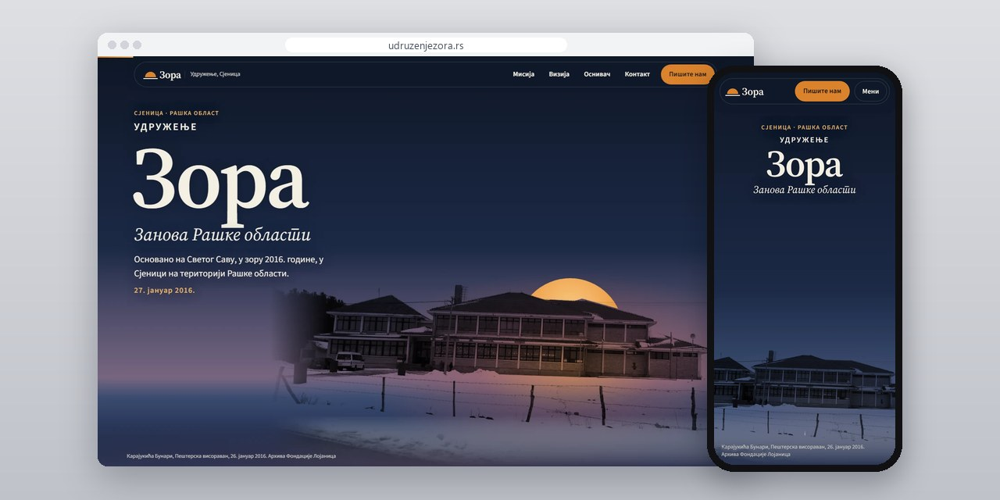
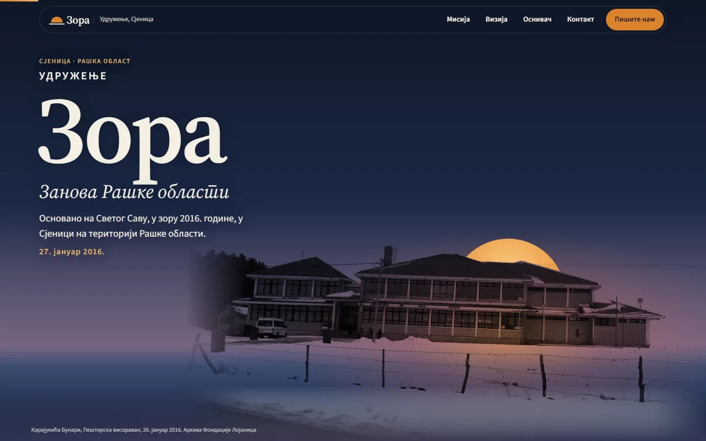
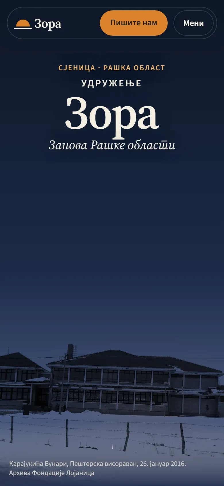
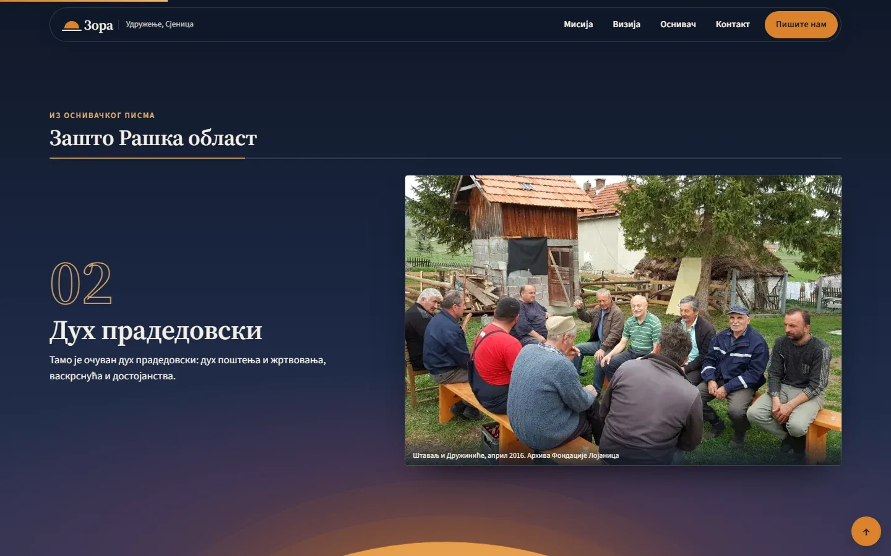
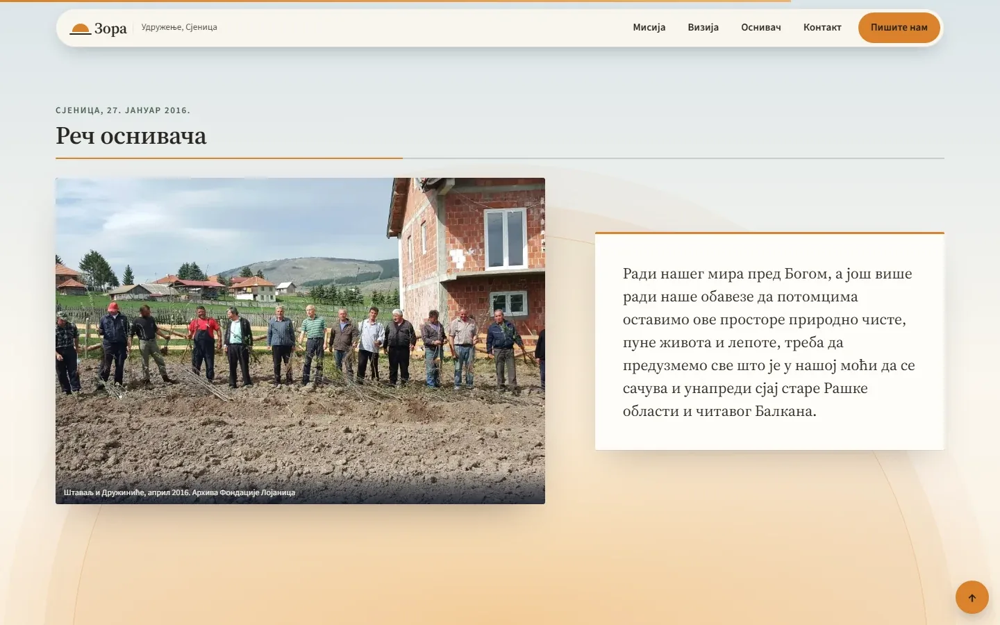

# Udruženje Zora

A one-page site in Serbian Cyrillic that turns a founding letter from 2016 into a scroll from night over Pešter to morning light.

**[udruzenjezora.rs](https://udruzenjezora.rs/)** · [Case study](https://svilenkovic.com/portfolio/udruzenje-zora) · [Srpski](README.sr.md)

> [!NOTE]
> Client project. The source code belongs to the client and stays in a private repository. This page describes what I built and how.

<table>
  <tr><td><b>Client</b></td><td>Udruženje Zora (Zanova Raške oblasti)</td></tr>
  <tr><td><b>Industry</b></td><td>Rural development and support for young people in the Raška region</td></tr>
  <tr><td><b>Location</b></td><td>Sjenica, Serbia</td></tr>
  <tr><td><b>Type</b></td><td>One-page website in pinned scenes</td></tr>
  <tr><td><b>My role</b></td><td>Design, development, SEO and hosting</td></tr>
  <tr><td><b>Stack</b></td><td>HTML, CSS, JavaScript, Cyrillic font subsets, JSON-LD</td></tr>
</table>

## About the project

Udruženje Zora was founded in Sjenica on St. Sava's Day 2016, under the name Zanova Raške oblasti. Before this site, its domain showed only a coming-soon page. I recovered the founding letter, the mission and the vision from the web archive of the old site, and the association confirmed its details before they went into the footer.

The page has six parts and 17 steps in pinned scenes: the frame stays still while scrolling changes the step. It opens at night with a school on the Pešter plateau under snow, the sun rises behind the building as the visitor scrolls, and the last three parts are in daylight, with the header bar changing color with the scene below it. The page never takes over the mouse wheel. With reduced motion, without JavaScript, or if the scene script does not start within three and a half seconds, all the steps stand one below another as plain text.

## What I built

- One page in Serbian Cyrillic: the opening, five reasons for the Raška region, the mission, four points of the vision, the founder's words and an invitation to join
- Pinned scenes that follow ordinary scrolling in both directions and fall back to plain text
- 14 archive photos from Fondacija Lojanica, each with the place, date and source below it
- Source Serif 4 and Source Sans 3 served from the same server as Cyrillic subsets, with no libraries
- A cookie banner, privacy policy and terms of use in Cyrillic, and analytics only after consent
- Structured data for a non-governmental organization with its founding date and place

## Results

| | Performance | Accessibility | Best practices | SEO |
| :-- | :-: | :-: | :-: | :-: |
| Mobile | 100 | 100 | 100 | 100 |
| Desktop | 100 | 100 | 100 | 100 |

PageSpeed Insights, lab test of the live site, November 2026. Security headers: 6 of 6. HTML validator: no errors. axe accessibility check: no violations. Structured data: `NGO`.

## Screenshots

<table>
  <tr>
    <td width="68%" valign="top"></td>
    <td width="32%" valign="top"></td>
  </tr>
</table>

Five reasons from the founding letter, each with a photo from the Fondacija Lojanica archive

The daylight part of the page: the founder's words from 2016

---

Built by [D. Svilenković](https://svilenkovic.com).
