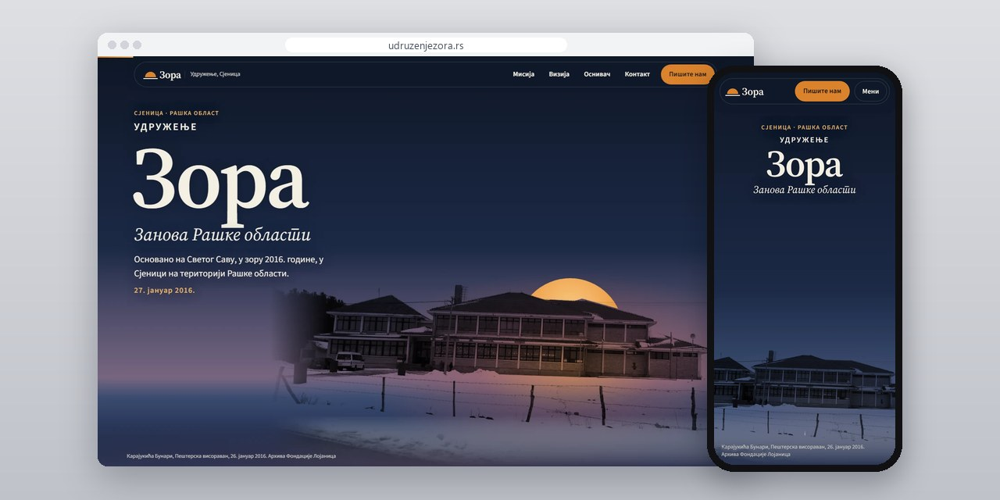
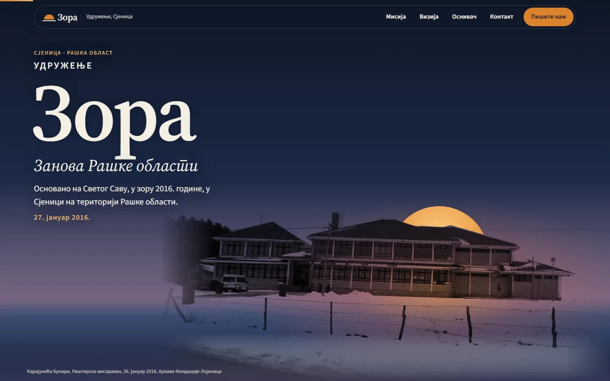
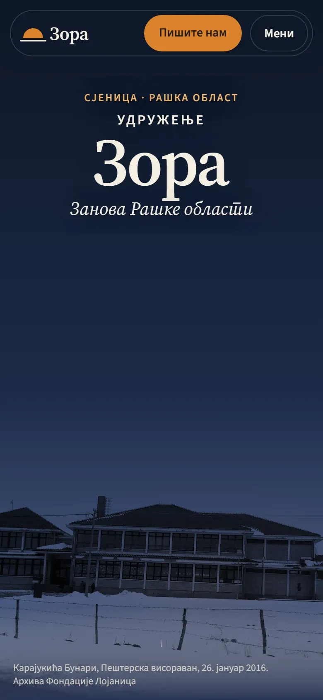
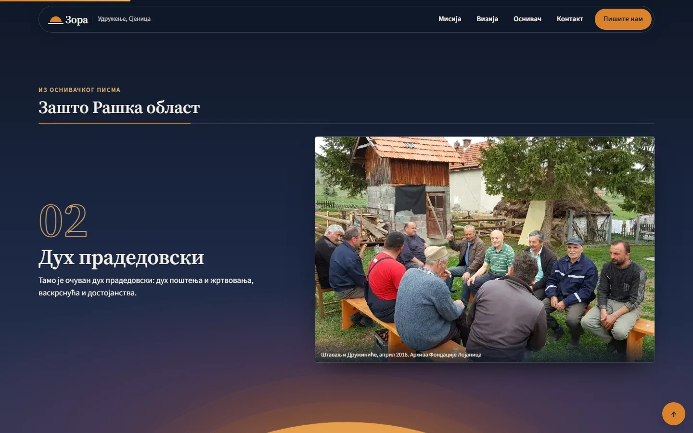
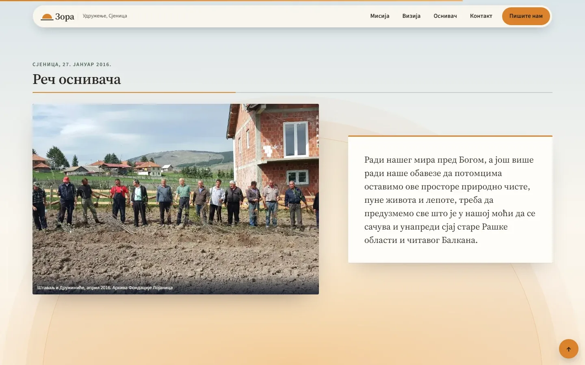

# Udruženje Zora

Sajt na jednoj strani na ćirilici koji osnivačko pismo iz 2016. pretvara u skrol od noći nad Pešterom do jutra.

**[udruzenjezora.rs](https://udruzenjezora.rs/)** · [Studija slučaja](https://svilenkovic.rs/radovi/udruzenje-zora) · [English](README.md)

> [!NOTE]
> Klijentski projekat. Izvorni kod pripada klijentu i čuva se u privatnom repozitorijumu. Ova stranica opisuje šta sam uradio i kako.

<table>
  <tr><td><b>Klijent</b></td><td>Udruženje Zora (Zanova Raške oblasti)</td></tr>
  <tr><td><b>Delatnost</b></td><td>Razvoj sela i podrška mladima u Raškoj oblasti</td></tr>
  <tr><td><b>Lokacija</b></td><td>Sjenica</td></tr>
  <tr><td><b>Vrsta</b></td><td>Sajt na jednoj strani u zakačenim scenama</td></tr>
  <tr><td><b>Moj deo posla</b></td><td>Dizajn, izrada, SEO i hosting</td></tr>
  <tr><td><b>Tehnologije</b></td><td>HTML, CSS, JavaScript, Cyrillic font subsets, JSON-LD</td></tr>
</table>

## O projektu

Udruženje „Zora“ osnovano je u Sjenici na Svetog Savu 2016. godine, pod imenom „Zanova Raške oblasti“. Pre ovog sajta domen je pokazivao samo stranu u pripremi. Tekst osnivačkog pisma, misije i vizije vratio sam iz veb arhive starog sajta, a podatke iz podnožja udruženje je potvrdilo pre objave.

Strana ima šest celina i 17 koraka u zakačenim scenama: kadar stoji, a skrol smenjuje korake. Počinje noću, školom na Pešterskoj visoravni pod snegom, dok posetilac skroluje iza zgrade izlazi sunce, a poslednje tri celine su dnevne, pa traka zaglavlja menja boju zajedno sa scenom ispod sebe. Strana ne preuzima točkić miša. Kada sistem traži manje pokreta, kada JavaScript ne radi ili kada skripta za scene ne krene u roku od tri i po sekunde, svi koraci stoje jedan ispod drugog kao običan tekst.

## Šta sam uradio

- Jedna strana na ćirilici: uvod, pet razloga zašto Raška oblast, misija, četiri tačke vizije, reč osnivača i poziv da se pridružite
- Zakačene scene koje prate običan skrol u oba smera i vraćaju se u običan tekst
- 14 fotografija iz arhive Fondacije Lojanica, ispod svake mesto, datum i izvor
- Fontovi Source Serif 4 i Source Sans 3 sa istog servera, kao isečci za ćirilicu, bez biblioteka
- Traka za kolačiće, politika privatnosti i uslovi korišćenja na ćirilici i analitika samo uz pristanak
- Strukturisani podaci za nevladinu organizaciju sa datumom i mestom osnivanja

## Merenja

| | Performanse | Pristupačnost | Dobre prakse | SEO |
| :-- | :-: | :-: | :-: | :-: |
| Telefon | 100 | 100 | 100 | 100 |
| Desktop | 100 | 100 | 100 | 100 |

PageSpeed Insights, laboratorijsko merenje živog sajta, novembar 2026. Sigurnosna zaglavlja: 6 od 6. HTML validator: bez grešaka. axe provera pristupačnosti: bez prekršaja. Strukturisani podaci: `NGO`.

## Snimci ekrana

<table>
  <tr>
    <td width="68%" valign="top"></td>
    <td width="32%" valign="top"></td>
  </tr>
</table>

Pet razloga iz osnivačkog pisma, svaki uz fotografiju iz arhive Fondacije Lojanica

Danji deo strane: reč osnivača iz 2016. godine

---

Izrada: [D. Svilenković](https://svilenkovic.rs).
